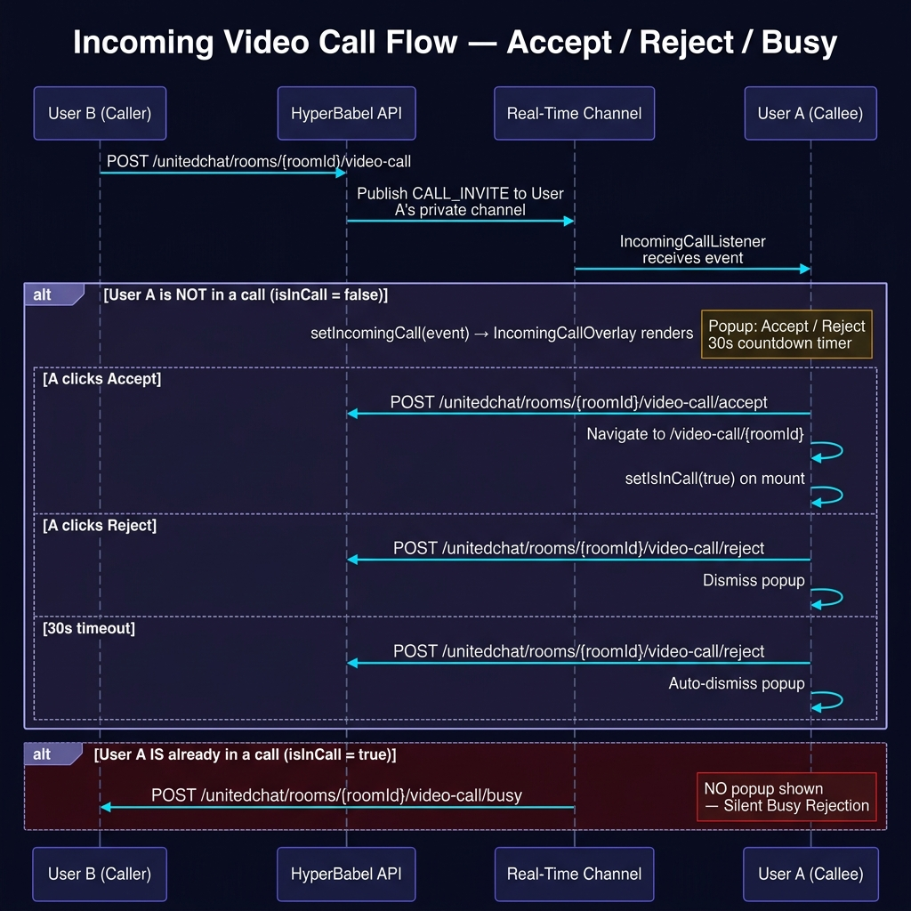

# HyperBabel React Demo Sample

A production-grade React web demo that showcases the HyperBabel API
Platform. Use it as a reference implementation for integrating HyperBabel
into your own React applications.

Authentication uses **Customer Auth pattern B1 — Firebase Direct
Exchange**. The browser signs in with Firebase, exchanges the resulting
ID token for a short-lived HyperBabel customer JWT, and uses that JWT for
every subsequent API call. **The integrator's organization API key
(`hb_live_…` / `hb_test_…`) never ships in the browser bundle.** The HTTP
client throws at startup if it ever sees one.

For the full architecture, see the
[Customer Auth section on the docs site](https://hyperbabel.com/docs#customer-auth).
The per-org Firebase project allow-list is configured in the
[HyperBabel Console](https://console.hyperbabel.com) under **Customer Auth**.

## Features

| Feature | APIs Used |
|---|---|
| **1:1 Chat** | United Chat — Rooms, Messages, Batch-Translate |
| **Group Chat** | United Chat — Rooms, Messages, Members, Sub-Admins, Ban/Unban |
| **Open Chat** | United Chat — Rooms, Join, Leave |
| **1:1 Video Call** | United Chat — Video Call (start, accept, reject, joined-rtc, heartbeat, renew-token, end) |
| **Group Video Call** | United Chat — Video Call (start, accept, joined-rtc, heartbeat, renew-token, leave, end) — up to 3 participants including the caller |
| **Incoming Call Popup** | Real-Time private channel — `CALL_INVITE` signal (works on every page) |
| **Live Stream (Host)** ⚠️ | Stream — Create, Start, End — **needs your backend**, see note below |
| **Live Stream (Viewer)** ⚠️ | Stream — Viewer Token — **needs your backend**, see note below |
| **Auto-Translation** | United Chat — `messages/batch-translate` (chat rooms and in-call chat) |
| **Standalone Translation / Language Detection** ⚠️ | Translation — Text, Batch, Detect, Languages — **needs your backend**, see note below |
| **In-Call Chat** | United Chat — Messages with auto-translation |
| **In-Call Live Captions** | Speech Translation — `wss /stt-relay` (live STT + translation subtitles), `GET /stt/languages` |
| **Live Stream Chat** ⚠️ | Chat — Channels, Messages — **needs your backend** (rides on the stream page above) |
| **File Upload** | Storage — Presign → Upload → Confirm (3-step) |
| **Typing Indicators** | United Chat — Typing endpoint |
| **Reactions** (display only) | Rendered from `message.reactions` + realtime deltas. Adding/removing is **not wired** in this demo — see `unitedChatService` for the end-user endpoint |
| **Message Threads** | Not wired in this demo — a reply is a message with `reply_to`; see the React Native demo for a working panel |
| **Full-Text Search** | Not wired in this demo — the search box filters the room list client-side. Server search is `GET /unitedchat/rooms/:id/search` |
| **Read Receipts** | United Chat — Mark as Read |
| **Pin Messages** | United Chat — Pin/Unpin |
| **Mute/Unmute Rooms** | United Chat — Mute/Unmute |
| **Freeze/Unfreeze** | United Chat — Freeze/Unfreeze |
| **Presence (Online/Offline)** | Presence — Heartbeat, Status, Bulk Query |
| **Push Notifications** | Push — Register/Unregister Token |
| **API Usage Monitoring** | Auth — Usage |

> Webhook CRUD, billing, and other tenant-admin endpoints aren't in the
> demo — they require a console-session JWT (not an API key) and are
> managed in the [HyperBabel Console](https://console.hyperbabel.com).

### ⚠️ Live streaming and standalone translation need your backend

The rows marked ⚠️ above are the only ones that do **not** run from this demo,
and that is by design rather than a gap.

Every `/stream/*` and `/translate/*` endpoint authenticates with your
**organization API key** (`Authorization: Bearer hb_live_…`). A request
carrying anything else is rejected before it reaches the handler:

```
POST /api/v1/stream/sessions
→ 401 { "error": { "code": "invalid_api_key_format" } }
```

Creating a broadcast allocates paid capacity and is metered against your
organization, so the caller has to be **you**, not a signed-in end user. This
demo holds only a customer JWT — `src/services/api.js` refuses to put an org
key in a browser bundle — so the demo does not call these endpoints at all.
(Calling them anyway would also be wasteful: the client answers every 401 by
refreshing the customer JWT, so a polling loop would churn refreshes.)

Run them as:

```
browser  →  your backend (holds hb_live_…)  →  HyperBabel /stream/*, /translate/*
```

`src/pages/LiveStreamPage.jsx` still documents the exact live-stream call
sequence and payloads, and `src/services/translateService.js` the translation
requests; implement them on your server and expose a thin endpoint the browser
can call.

Chat translation is **not** affected: chat rooms and the in-call chat use
`POST /unitedchat/rooms/{roomId}/messages/batch-translate`, which accepts the
customer JWT. Everything else in this demo — chat (including its
auto-translation), video calls, storage, presence, push — is an end-user
surface and runs as-is.

---

## Quickstart — from zero to running app

1. **Sign up at the HyperBabel Console** —
   <https://console.hyperbabel.com>. Once your organization exists,
   open **Customer Auth → Add Firebase project**.

2. **Allow-list your Firebase project**. In the console wizard:
   - Paste your Firebase project ID (e.g. `your-app-prod`).
   - Paste a Firebase ID token to prove ownership (the wizard shows two
     ways to generate one).
   - Click *Verify and add*. This step tells HyperBabel "trust ID tokens
     from this Firebase project."

3. **Enable sign-in methods in Firebase Console**:
   - Authentication → Sign-in method → enable **Email/Password** (and
     **Anonymous** if you want the kiosk-mode button on the login screen).
   - Authentication → Settings → Authorized domains → ensure your dev
     origin (`localhost` is allow-listed by default) and any prod hostname
     are present. Without this, Firebase rejects sign-in with `auth/unauthorized-domain`.

4. **Copy your Firebase Web SDK config** from Firebase Console → Project
   Settings → Your apps → Web → "Config" snippet. You need
   `apiKey`, `authDomain`, `projectId`, `storageBucket`,
   `messagingSenderId`, `appId`.

5. **Install, configure, and run**:
   ```bash
   cd sample_demos/react
   cp .env.example .env.local
   #  → paste your Firebase Web SDK values into the VITE_FIREBASE_* slots
   npm install
   npm run dev
   ```
   Open <http://localhost:5173> in your browser. The login screen renders
   a sign-in form when Firebase is configured, or a "Firebase config
   missing" hint otherwise.

That's the whole setup. Sign in (or create an account), and the demo
will exchange the Firebase ID token for a customer JWT, store the pair in
`localStorage`, and route you into the main app.

### Browser storage trade-off

The customer JWT lives in `localStorage`, which is XSS-readable. This is
the inherent cost of any client-direct B1 flow. The risk is bounded —
customer JWTs are short-lived (1 h access, 30 d refresh) and scoped to
a single end-user; they cannot create new users or touch billing. For
higher assurance, host an httpOnly-cookie backend that brokers the
exchange (pattern B2 in the [Customer Auth docs](https://hyperbabel.com/docs#customer-auth)).

---

## Environment Variables

| Variable | Required | Description |
|---|---|---|
| `VITE_HB_API_URL` | no | API base URL. Defaults to `https://api.hyperbabel.com/api/v1`. |
| `VITE_FIREBASE_API_KEY` | yes | Firebase Web SDK — apiKey |
| `VITE_FIREBASE_AUTH_DOMAIN` | yes | Firebase Web SDK — authDomain |
| `VITE_FIREBASE_PROJECT_ID` | yes | Firebase Web SDK — projectId |
| `VITE_FIREBASE_STORAGE_BUCKET` | yes | Firebase Web SDK — storageBucket |
| `VITE_FIREBASE_MESSAGING_SENDER_ID` | yes | Firebase Web SDK — messagingSenderId |
| `VITE_FIREBASE_APP_ID` | yes | Firebase Web SDK — appId |
| `VITE_FIREBASE_VAPID_KEY` | no | Generate in Firebase Console → Cloud Messaging → Web Push Certificates. Required only for browser push. |

There is no API-key env var — the demo only accepts customer JWTs minted
via Firebase Direct Exchange. Setting `VITE_HB_API_KEY` to an `hb_live_…`
/ `hb_test_…` value makes the HTTP client throw at startup.

All variables must be prefixed with `VITE_` to be inlined into the Vite
bundle.

### 🔒 CORS & Allowed Origins

HyperBabel APIs enforce **Strict Origin Validation** for org API keys.
That validation does NOT apply to customer JWTs from Firebase Direct
Exchange (the bearer is the per-end-user JWT, not your org key), so this
demo works from any authorized Firebase domain without extra console
configuration.

---

## Project Structure

```
react/
├── src/
│   ├── services/                   # API service modules
│   │   ├── api.js                  # Customer JWT HTTP client (B1)
│   │   ├── firebaseAuthService.js  # Firebase → /customer/auth/firebase-exchange
│   │   ├── firebaseService.js      # FCM web push registration (optional)
│   │   ├── authService.js          # Auth — Usage
│   │   ├── unitedChatService.js    # United Chat — Rooms, Messages, Video Call, Ban, Mute, Freeze
│   │   ├── chatService.js          # Chat — Low-level channels, messages, reactions, threads
│   │   ├── videoService.js         # Video — Standalone session management
│   │   ├── streamService.js        # Stream — Live broadcast sessions (org API key — backend only)
│   │   ├── translateService.js     # Translation — Text, Batch, Detect, Languages (org API key — backend only)
│   │   ├── storageService.js       # Storage — 3-step presigned-URL upload
│   │   ├── realtimeService.js      # Real-Time channel subscriptions
│   │   ├── rtcService.js           # Video / Live Stream engine wrapper
│   │   ├── presenceService.js      # Presence — Heartbeat, Status, Bulk query
│   │   └── pushService.js          # Push — FCM token management
│   │
│   ├── components/                 # Reusable UI components
│   │   ├── Header.jsx              # Navigation header with presence toggle
│   │   ├── ChatMessageList.jsx     # Scrollable message list with translations
│   │   ├── IncomingCallListener.jsx # App-wide real-time connection + CALL_INVITE listener
│   │   ├── IncomingCallOverlay.jsx # Incoming call popup
│   │   └── ChatInput.jsx           # Message input with file attach & typing
│   │
│   ├── context/
│   │   ├── AuthContext.jsx         # Customer JWT lifecycle (sign-in, refresh, logout)
│   │   └── CallContext.jsx         # Global video call state
│   │
│   ├── pages/                      # Page-level components
│   │   ├── LoginPage.jsx           # Firebase Email/Password sign-in + Anonymous
│   │   ├── SignUpPage.jsx          # Firebase createUser → exchange
│   │   ├── DashboardPage.jsx       # Sandbox Hub
│   │   ├── ChatHubPage.jsx         # Unified Chat Hub
│   │   ├── VideoCallPage.jsx       # Video call with in-call chat
│   │   ├── LiveStreamPage.jsx      # Live stream (host/viewer) with chat
│   │   └── SettingsPage.jsx        # Usage, Push tokens
│   │
│   ├── utils/
│   │   └── ringtone.js             # Incoming call ringtone via Web Audio API
│   │
│   ├── App.jsx                     # React Router + Auth/Call providers
│   ├── main.jsx                    # Application entry point
│   └── index.css                   # Global CSS design system (dark theme)
│
├── docs/
│   └── video_call_flow.png         # Incoming call flow sequence diagram
│
├── .env.example                    # Environment variables template
├── index.html                      # HTML entry point
├── package.json                    # Dependencies (React 19, Vite 5.4)
└── README.md                       # This file
```

---

## Incoming Video Call Flow

The diagram below illustrates the full lifecycle of an incoming video call:
accepting, rejecting, the auto-reject timeout (45 seconds in this demo), and
the busy-rejection path when the callee is already in another call.



> The diagram predates two details — the table below is authoritative: the
> ring timeout is **45 s** (not 30 s), and a busy callee is declined with
> `POST …/video-call/reject` and `reason: 'busy'` (there is no
> `…/video-call/busy` endpoint). Every accept / reject also sends `session_id`.

| Scenario | API Call | Result |
|---|---|---|
| **Accept** | `POST /unitedchat/rooms/{roomId}/video-call/accept` `{ user_id, session_id }` | Navigate to VideoCallPage (410 = caller already hung up → popup closes) |
| **Reject** | `POST /unitedchat/rooms/{roomId}/video-call/reject` `{ user_id, session_id }` | Dismiss popup |
| **Timeout (45 s)** | `POST /unitedchat/rooms/{roomId}/video-call/reject` `{ …, reason: 'missed' }` | Auto-dismiss |
| **Busy (in another call)** | `POST /unitedchat/rooms/{roomId}/video-call/reject` `{ …, reason: 'busy' }` | Silent rejection, no popup |
| **Caller hangs up while ringing** | — (a `call_ended` event arrives on the room channel) | Popup closes |

> The incoming call arrives on the HyperBabel Real-Time private channel
> (`user:{orgId}:{userId}`) as an event named `signal` whose payload has
> `type: 'CALL_INVITE'` plus `sessionId`, `roomId`, `channelName`,
> `callType` and `roomSignalChannel`. `IncomingCallListener.jsx` opens the
> real-time connection at sign-in and keeps that subscription alive on every
> page (`AuthContext.logout()` closes it). The global `isInCall` flag
> (`CallContext.jsx`) determines whether the popup is shown or a silent
> busy-rejection is sent instead. Every call action — accept, reject, leave,
> end — must send the invite's `sessionId` as `session_id`.

### On the call screen

Call events arrive on the room's real-time channel as `video_call` system
messages (event `message`, `data.metadata = { event, session_id, … }`;
`event` is `call_started`, `call_accepted`, `call_ended`, `call_rejected`,
`call_missed` or `call_busy`). `VideoCallPage.jsx` reacts like this:

| Situation | What the demo does |
|---|---|
| `call_ended` for this session | Leaves the screen (no API call — the session is over) |
| Caller of a 1:1 call, nobody joined yet, `call_rejected` / `call_missed` / `call_busy` | `POST …/video-call/leave`, shows "Declined" / "No answer" / "Busy", leaves |
| Caller of any call, nobody joined 45 s after the caller is in the call | `POST …/video-call/leave`, shows "No answer", leaves |
| The last other participant leaves the media channel | `POST …/video-call/leave`, leaves (a group call carries on while anyone remains) |
| While connected | `joined-rtc` once, `heartbeat` every 60 s, `renew-token` before the 1-hour RTC token expires |

The chat screen renders these events as one-line notices ("Video call
started", "Video call ended", "Call declined", …); live-caption messages that
also ride the room channel are not added to the chat list.

---

## API Integration Patterns

### 1. Base API Client

All API calls go through `src/services/api.js`, which attaches the
customer JWT and refreshes it transparently on 401:

```javascript
import api from './services/api';

// GET with query parameters
const rooms = await api.get('/unitedchat/rooms', { user_id: 'user-001' });

// POST with JSON body
const room = await api.post('/unitedchat/rooms', {
  room_type: 'group',
  creator_id: 'user-001',
  room_name: 'Team Chat',
  members: ['user-002', 'user-003'],
});
```

### 2. United Chat — Creating Rooms

```javascript
import * as unitedChat from './services/unitedChatService';

// 1:1 DM (returns existing room if already exists)
const dm = await unitedChat.createRoom({
  room_type: '1to1',
  creator_id: 'alice',
  members: ['bob'],
});

// Group chat
const group = await unitedChat.createRoom({
  room_type: 'group',
  creator_id: 'alice',
  room_name: 'Project Alpha',
  members: ['bob', 'charlie'],
});

// Open (public) room
const open = await unitedChat.createRoom({
  room_type: 'open',
  creator_id: 'alice',
  room_name: 'Community Hub',
});
```

### 3. Auto-Translation

```javascript
const { messages } = await unitedChat.getMessages(roomId, { limit: 50 });

const otherMsgIds = messages
  .filter((m) => m.sender_id !== myUserId)
  .map((m) => m.id);

// Up to 100 ids per call. Works with the end-user token.
const { translations } = await unitedChat.batchTranslateMessages(
  roomId, otherMsgIds, 'ko', // → Korean
);
// translations = { [messageId]: 'translated text', ... }
// (plus `limited: true` when the user hit the daily fair-use translation limit)
```

### 4. Video Call from Chat Room

```javascript
// Caller — the response carries the session id every later call needs.
const { session } = await unitedChat.startVideoCall(roomId, myUserId);

// Callee — `sessionId` comes with the CALL_INVITE signal.
await unitedChat.acceptVideoCall(roomId, myUserId, sessionId);
await unitedChat.rejectVideoCall(roomId, myUserId, sessionId); // or reason 'missed' / 'busy'

// While connected (see VideoCallPage.jsx):
await unitedChat.markJoinedRtc(roomId, myUserId, session.id);          // once, after the media join
await unitedChat.sendVideoCallHeartbeat(roomId, myUserId, session.id); // every 60 s
const { rtc_token } = await unitedChat.renewVideoCallToken(roomId, myUserId, session.id); // before the 1-hour token expires

// Hang up
await unitedChat.leaveVideoCall(roomId, myUserId, session.id); // just me
await unitedChat.endVideoCall(roomId, myUserId, session.id);   // everyone (caller, room owner or sub-admin only)
```

### 5. File Upload (3-step presign)

```javascript
import * as storage from './services/storageService';

// Convenience helper that runs all three steps
const metadata = await storage.uploadFile(fileObject, channelId);

// Manual:
const { upload_url, key } = await storage.presign({
  filename: 'photo.jpg',
  mimeType: 'image/jpeg',
  fileSize: 1024000,
});
await storage.uploadToPresignedUrl(upload_url, file, 'image/jpeg');
const { url } = await storage.confirmUpload({ key, originalName: 'photo.jpg' });
```

### 6. Presence Heartbeat

```javascript
import * as presence from './services/presenceService';

setInterval(() => presence.heartbeat(myUserId, 'web'), 30000);
const { presence: statuses } = await presence.getPresence(['alice', 'bob']);
```

---

## Customization

- **Styling**: edit `src/index.css` — all colors, radii, and shadows are
  CSS custom properties.
- **API URL**: change `VITE_HB_API_URL` in `.env.local` to point at a
  private HyperBabel deployment.
- **Languages**: extend the `<select>` options in `LoginPage.jsx` /
  `SignUpPage.jsx`.
- **Real-time**: new messages, typing indicators, edits, deletes, and
  call invitations all arrive via the HyperBabel Real-Time channel
  subscription wired up in `services/realtimeService.js` and
  `components/IncomingCallListener.jsx` — no polling.

---

## License

This project is licensed under the MIT License — see the [LICENSE](LICENSE)
file for details.

> **Disclaimer.** This code is provided for demonstration purposes only.
> It is not intended for production environments without proper security
> and performance reviews.

---

## Video Resolution & Billing Tier

Video and live streaming are metered by **resolution tier**, decided by the
total resolution each participant *receives*. This demo keeps every call
inside the HD budget (921,600 px per participant) and declares the matching
tier on every session-creation call:

- `src/services/videoQuality.js` — the presets and the `quality` value are both defined here.
- 1280 × 720 when a participant receives at most one remote stream
  (live-stream host, 1:1 call); 640 × 480 from three participants up. Chat-room
  calls (the ones this demo starts) allow at most 3 participants including the
  caller; the standalone `/video/sessions` API allows 4, and even a four-way
  call still totals 3 × 307,200 = 921,600 px.
- `quality` is sent as `"hd"`. If you publish above these presets, change the
  preset **and** the declared tier together in that one file — the declared
  value is what your invoice is calculated from (Terms §5.1 / §5.2).
- The roster is re-evaluated on every join **and** every leave, so a call
  that drops from three participants to two moves back up to 1280 × 720 and a
  participant who rejoins pulls everyone back down before publishing a frame.

### Always send `publish_resolution`

Every session-creation call in this demo sends `publish_resolution` alongside
`quality`, and **your app should too**. The API accepts a request without it,
but leaving it out is how the most common billing surprise happens.

```
POST /api/v1/video/sessions
{
  "call_type": "group",
  "participants": [ ... ],
  "quality": "hd",
  "publish_resolution": { "width": 640, "height": 480 }
}
```

- **What the value means.** The resolution this session will actually publish
  **at this participant count** — not your camera's maximum, and not a
  constant. Build it with `publishResolutionFor(participantCount)` in
  `src/services/videoQuality.js`, which derives it from the same presets the
  encoder uses, so the number you send and the pixels you emit cannot drift
  apart.
- **What HyperBabel does with it.** It multiplies the value by the number of
  streams one participant receives — participants − 1 for a call, 1 for a
  broadcast, since a viewer subscribes to the host only — and compares the
  total against `quality`. If the total lands in a higher tier, the creation
  response carries a `quality_warning` string. The session is still created and
  nothing is blocked.
- **It never changes your bill.** Billing follows `quality`, always. This field
  exists so you can catch a wrong `quality` before the invoice does.
- **Why it matters.** The mistake it catches is not dishonesty, it is a unit
  mismatch: 720p is genuinely HD in a 1:1 call and genuinely *above* HD in a
  four-way one, because tiers are computed on the total each participant
  receives. Declaring `"hd"` while publishing 720p to three other people is an
  honest answer to the wrong question — and without this field nothing tells
  you so.
- **Read `quality_warning` and act on it.** Log it at minimum. If it appears,
  either lower the publishing resolution or declare the tier it names. Do not
  ignore it: your invoice is calculated from `quality`, and the difference is
  recoverable under Terms §5.2.

See the [root README](../README.md#video-resolution--billing-tier) for the
full table and the reasoning.
